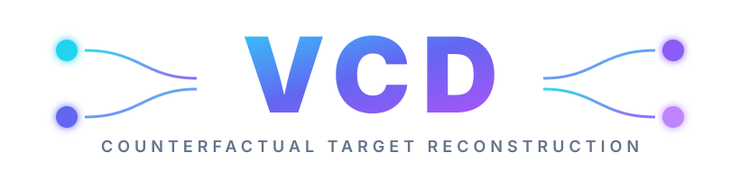
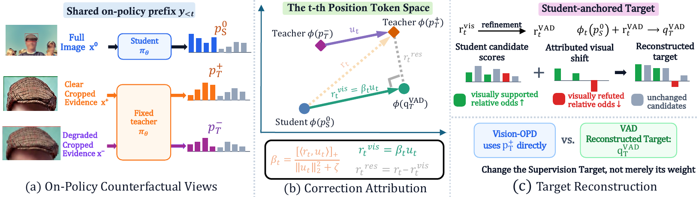
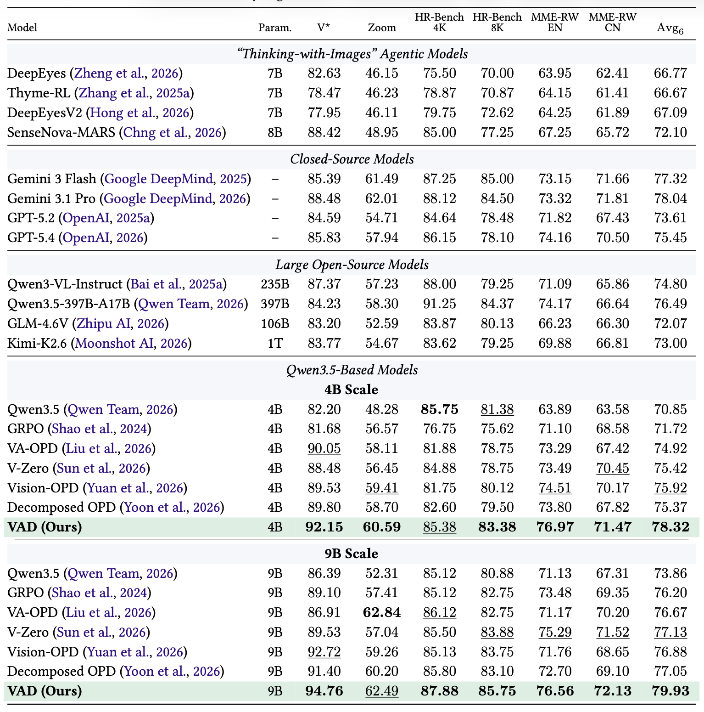

<h1 align="center">
  <br>
  <sub>Counterfactual target reconstruction for multimodal on-policy distillation</sub>
</h1>

<div align="center">

[](https://www.python.org/downloads/) [](LICENSE) [](docs/OPEN_SOURCE_PLAN.md)
[](#-training) [](#-training) [](#-official-evaluation) [](#-official-evaluation)

</div>

<p align="center">
  <a href="#-release-status">Status</a> |
  <a href="#-overview">Overview</a> |
  <a href="#-highlights">Highlights</a> |
  <a href="#-main-results">Results</a> |
  <a href="#-repository-layout">Layout</a> |
  <a href="#-installation">Installation</a> |
  <a href="#-quick-start">Quick Start</a> |
  <a href="#-data-pipeline">Data</a> |
  <a href="#-training">Training</a> |
  <a href="#-official-evaluation">Evaluation</a> |
  <a href="#-release-roadmap">Roadmap</a> |
  <a href="#-citation">Citation</a>
</p>

<h5 align="center">A focused release for training VCD and reporting results with the official evaluation protocol.</h5>

<div align="center">
  
</div>

## 📣 Release Status

> [!NOTE]
> **Phase 1 is code-complete.** This repository contains the training runtime,
> reproducible three-view data construction, checkpoint utilities, mandatory
> training-time benchmark monitoring, and the audited official evaluation path.

| Available now | Planned for Phase 2 |
| --- | --- |
| Training, data preparation, fast monitoring, official evaluation, tests | Paper link, selected checkpoints, processed dataset release, verified citation |

Paper, model checkpoint, and processed dataset links will be added only after
their public artifacts exist.

## 💡 Overview

**VCD** learns from three aligned visual conditions at each student-generated
prefix: the student's full image, a clear evidence-present teacher crop, and an
evidence-degraded version of the same crop. Rather than directly matching the
complete privileged teacher distribution, VCD reconstructs a student-anchored
target from the correction attributable to the controlled visual-evidence
intervention.



This is a deliberately focused open-source release. Historical analysis
notebooks, one-off launchers, local-judge result tables, logs, checkpoints, and
unrelated upstream experimental recipes are excluded from the public path.

## ✨ Highlights

<table>
  <tr>
    <td width="50%"><strong>👁️ Explicit evidence conditions</strong><br>Every row records the full student image, clear evidence crop, and matched evidence-degraded crop.</td>
    <td width="50%"><strong>🧭 Counterfactual target reconstruction</strong><br>The runtime isolates the controlled visual correction and applies a budgeted asymmetric target.</td>
  </tr>
  <tr>
    <td width="50%"><strong>🧊 Fixed initial teacher</strong><br>Public profiles keep the teacher at the initial checkpoint while the student learns from its own rollout prefixes.</td>
    <td width="50%"><strong>📈 Comparable W&amp;B runs</strong><br>The 4B and 9B profiles share one W&amp;B project, <code>VCD</code>, for direct curve comparison.</td>
  </tr>
  <tr>
    <td width="50%"><strong>⚡ Mandatory online monitoring</strong><br>VStar, ZoomBench, HRBench-4K, and HRBench-8K run every 10 training steps.</td>
    <td width="50%"><strong>✅ Audited official reporting</strong><br>Final results use the Vision-OPD pipeline, GPT-OSS-120B, strict <code>Yes</code>/<code>No</code> repair, and completeness gates.</td>
  </tr>
</table>

## 📊 Main Results

Under matched Qwen3.5 initialization, training data, and post-training budget,
VAD reaches an average score of **78.32** at the 4B scale and **79.93** at the
9B scale across six fine-grained visual benchmarks. Formal scores use the
Vision-OPD official pipeline with GPT-OSS-120B as the judge.



## 🗂️ Repository Layout

```text
VCD/
├── assets/                         # README wordmark, framework, and result figures
├── chat_templates/                 # Qwen3.5 perception chat template
├── configs/
│   ├── vcd_4b.env                  # Reproduction-oriented 4B profile
│   └── vcd_9b.env                  # Reproduction-oriented 9B profile
├── data/                           # Generated locally; payloads are ignored
├── docs/
│   ├── DATA.md                     # Three-view construction and schema
│   ├── TRAINING.md                 # Profiles, W&B, and online evaluation
│   ├── EVALUATION.md               # Official GPT-OSS evaluation protocol
│   └── OPEN_SOURCE_PLAN.md         # Release scope and later phases
├── evaluation/
│   ├── prepare_fast_eval_data.py   # Four-set training validation builder
│   └── vision_opd_official/        # Official inference, judge, and scoring
├── scripts/
│   ├── prepare_data.py             # Download, degrade, package, and verify
│   ├── prepare_benchmarks.sh       # Prepare fast and formal benchmark data
│   ├── train_vcd.sh                # 4B/9B training entrypoint
│   ├── merge_checkpoint.sh         # FSDP to Hugging Face conversion
│   ├── serve_checkpoint.sh         # Official-style model serving
│   ├── serve_gpt_oss_120b.sh       # GPT-OSS judge serving profile
│   └── evaluate_official.sh        # Audited six-benchmark evaluation
├── tests/                           # Target, data, and integrity tests
└── verl/                            # Curated training runtime
```

The internal identifiers `target_mode=vc` and
`vc_target_variant=budgeted_asvc` are retained for compatibility with validated
experiment artifacts. They are implementation names, not additional public
methods.

## 🔧 Installation

### Training environment

```bash
conda create -n vcd python=3.12 -y
conda activate vcd

pip install --upgrade pip
pip install --no-deps -r requirements.txt
pip install -e . --no-deps
pip install flash-attn --no-build-isolation
pip install causal-conv1d==1.6.1 --no-build-isolation
```

The frozen requirements describe the validated CUDA software stack. On a
different CUDA or PyTorch stack, install matching PyTorch and vLLM builds first,
then install this repository without dependency resolution.

### Evaluation-only environment

```bash
python3 -m venv .venv-eval
source .venv-eval/bin/activate
pip install -r requirements-eval.txt
```

## 🏃 Quick Start

### 1. Prepare training and benchmark data

```bash
python scripts/prepare_data.py --data-dir data
bash scripts/prepare_benchmarks.sh
```

### 2. Start GPT-OSS-120B

```bash
CUDA_VISIBLE_DEVICES=0,1,2,3,4,5 \
bash scripts/serve_gpt_oss_120b.sh
```

The default judge endpoint is `http://127.0.0.1:8900/v1`. For a judge hosted on
another machine, keep `HOST=0.0.0.0` on the server and export its private-network
endpoint on the training machine.

### 3. Train VCD

```bash
export WANDB_API_KEY="..."
export BENCHMARK_EVAL_JUDGE_API_BASE="http://JUDGE_HOST:8900/v1"

bash scripts/train_vcd.sh --profile 4b
# or
bash scripts/train_vcd.sh --profile 9b
```

Inspect the resolved release invariants without allocating model memory:

```bash
bash scripts/train_vcd.sh --profile 4b --dry-run
```

### 4. Merge and serve a selected checkpoint

```bash
bash scripts/merge_checkpoint.sh \
  checkpoints/<run>/global_step_<step> \
  checkpoints/<run>/global_step_<step>_merged

CUDA_VISIBLE_DEVICES=0,1,2,3,4,5,6,7 \
bash scripts/serve_checkpoint.sh \
  checkpoints/<run>/global_step_<step>_merged \
  VCD
```

### 5. Run the official final evaluation

```bash
MODEL_API_BASE="http://127.0.0.1:8000/v1" \
MODEL_ID="VCD" \
MODEL_TAG="vcd_step_selected" \
JUDGE_API_BASE="http://JUDGE_HOST:8900/v1" \
bash scripts/evaluate_official.sh
```

## 👁️ Data Pipeline

Every training sample has one question and three aligned visual conditions:

| Semantic condition | Parquet column | Runtime role |
| --- | --- | --- |
| Student full image | `images` | Rollout policy |
| Evidence present | `bbox_images` | Fixed teacher |
| Evidence degraded | `degraded_bbox_images` | Counterfactual teacher |

The evidence-degraded view is created from the evidence-present crop by
bilinear downsampling to 10 percent of its width and height, followed by
nearest-neighbor upsampling to the original crop resolution.

Preparation verifies every referenced path, row count, semantic mapping, and
present/degraded image size before writing `data/vcd_data_manifest.json`.

```bash
# Rebuild from an existing local download.
python scripts/prepare_data.py --data-dir data --skip-download --overwrite

# Verify all rows without rewriting.
python scripts/prepare_data.py --data-dir data --verify-only
```

See [Data preparation](docs/DATA.md) for the complete schema and validation
contract.

## 🚀 Training

### Public profiles

| Setting | 4B | 9B |
| --- | ---: | ---: |
| Base model | `Qwen/Qwen3.5-4B` | `Qwen/Qwen3.5-9B` |
| Train batch size | 96 | 96 |
| PPO mini-batch size | 96 | 96 |
| Rollouts per sample | 8 | 8 |
| Learning rate | `2e-6` | `2e-6` |
| Positive support cap | 0.8 | 0.7 |
| Weak teacher anchor | 0.1 | 0.1 |
| Default training steps | 130 | 130 |

> [!IMPORTANT]
> Public launchers keep the following contract enabled and do not allow profile
> files or inherited shell variables to disable it:
>
> ```text
> BENCHMARK_EVAL_ENABLE=True
> BENCHMARK_EVAL_FREQ=10
> BENCHMARK_EVAL_BENCHMARKS=vstar,zoombench,hrbench-4k,hrbench-8k
> ```

Validation metrics are emitted under
`val-core/<benchmark>/acc/mean@1` and logged to the same W&B run as the training
curves. These scores are intended for monitoring and checkpoint selection; they
are not official final results.

See [Training guide](docs/TRAINING.md) for profile overrides, endpoint
preflight, W&B organization, and output locations.

## 🧪 Official Evaluation

> [!IMPORTANT]
> The formal main-table protocol is **Vision-OPD official pipeline +
> GPT-OSS-120B judge**. Training-time scores and legacy local-judge outputs are
> diagnostic results only.

The final path uses:

1. `evaluation/vision_opd_official/infer.py`;
2. `evaluation/vision_opd_official/judge_qwenlm.py`;
3. `evaluation/vision_opd_official/cal_acc.py`;
4. VCD completeness audits and noncanonical-judge repair.

| Component | Formal setting |
| --- | --- |
| Benchmarks | VStar, ZoomBench, HRBench-4K, HRBench-8K, MME-RealWorld, MME-RealWorld-CN |
| Model server context | `max_model_len=32768` |
| Model response budget | `MAX_TOKENS=8192` |
| Thinking | `ENABLE_THINKING=False` |
| Seed | 42 |
| Judge | `openai/gpt-oss-120b` |
| Judge endpoint | `http://127.0.0.1:8900/v1` by default |
| Judge response budget | 2048 |
| Temperature | 0 |

The wrapper rejects partial benchmark lists and refuses to summarize a run when
answer counts, judge counts, stable sample IDs, or exact `Yes`/`No` labels are
incomplete.

<details>
<summary><strong>Reuse complete model answers without rerunning inference</strong></summary>

```bash
REUSE_ANSWER_ROOT="/path/to/model_answer" \
REUSE_MODEL_TAG="existing_tag" \
MODEL_TAG="vcd_rejudge" \
MODEL_ID="VCD" \
JUDGE_API_BASE="http://JUDGE_HOST:8900/v1" \
bash scripts/evaluate_official.sh
```

The wrapper links the existing answers into a fresh run, executes the official
judge and scorer, and records the resolved answer source in every audit.

</details>

<details>
<summary><strong>Result integrity gates</strong></summary>

- answer and judge counts must match the prepared benchmark;
- answer and judge sample IDs must be unique and aligned;
- empty responses and API/future error markers are rejected;
- explanatory judge outputs are normalized only when they begin with a clear
  `Yes` or `No`;
- all other invalid labels are retried one sample at a time;
- scoring stops if any judge value remains outside the exact set `Yes`, `No`.

</details>

See [Official evaluation guide](docs/EVALUATION.md) for file layouts, answer
reuse, judge serving, and protocol boundaries.

## 📦 Outputs

| Path | Content | Git policy |
| --- | --- | --- |
| `checkpoints/<experiment>/` | FSDP actor checkpoints | Ignored |
| `rollouts/<experiment>/` | Training rollout records | Ignored |
| `logs/<experiment>/launch.env` | Sanitized launch configuration | Ignored |
| `wandb/` | Local W&B cache | Ignored |
| `outputs/official_eval/<run>/` | Answers, judges, audits, logs, and summaries | Ignored |

Each completed official run contains `summary.md` and `summary.json`. The JSON
records inference and judge settings, evaluator hashes, source commit, answer
reuse status, and per-benchmark completeness counts.

## 🗺️ Release Roadmap

| Phase | Scope | Status |
| --- | --- | --- |
| Phase 1 | Training, data construction, fast monitoring, official evaluation, tests | ✅ Ready |
| Phase 2 | Public checkpoints, processed dataset artifacts, paper and verified citation | ⏳ Planned |
| Phase 3 | Curated scripts for reproducing paper figures and tables | ⏳ Planned |

The complete release boundary and publication checklist are maintained in
[Open-source release plan](docs/OPEN_SOURCE_PLAN.md).

## 📄 Provenance and License

The training runtime is derived from
[Vision-OPD](https://github.com/VisionOPD/Vision-OPD) and
[verl](https://github.com/volcengine/verl). The final benchmark implementation
is derived from the Vision-OPD official evaluator at commit `c2e345f`.
Modifications add VCD target construction, paired counterfactual-view routing,
Qwen3.5 compatibility, reproducibility controls, and result-integrity checks.

This project is released under the [Apache License 2.0](LICENSE). See
[NOTICE](NOTICE) for attribution details.

## 📝 Citation

The VCD citation entry will be added after the paper receives a public
identifier. No provisional or fabricated bibliographic entry is included.
